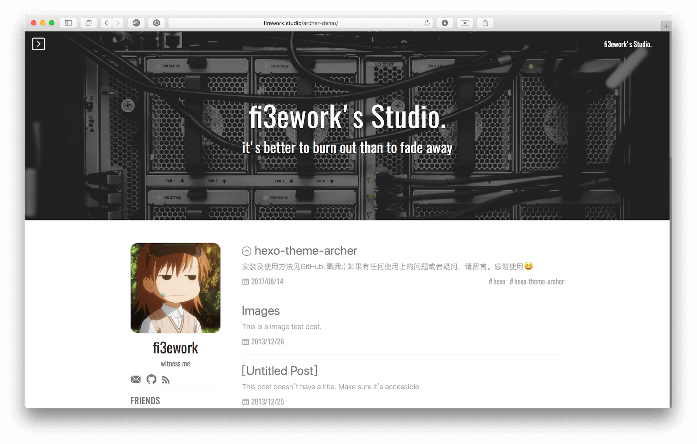

# hexo-theme-archer



## 在线预览

🎯 主题预览：[Demo](https://fi3ework.github.io/hexo-theme-archer)

## 文档

- [English document](./docs/README-en.md)
- [二次开发文档](./docs/develop-guide-zh.md)
- [文章音乐播放器（本地扩展）](./docs/music.md)
- [第三方前端资源清单](./THIRD_PARTY.md)

## 说明

由于作者精力有限，无法保证此主题继续维护，欢迎您 Fork 👋🏻 本仓库或[申请成为维护者 👩‍🔧](https://github.com/fi3ework/hexo-theme-archer/issues/256)。

- 本主题受 [yilia](https://github.com/litten/hexo-theme-yilia) 主题和 [huxpro](https://github.com/Huxpro/huxpro.github.io) 主题的启发，结合了前者的 sidebar 设计及后者的 UI 设计。通过 sidebar 能够快速执行 archive, tag 以及 categories 导航。
- 兼容性：现代浏览器及 IE10+。
- 有任何使用上的问题欢迎[发起 issue](https://github.com/fi3ework/hexo-theme-archer/issues/new/choose)。

## 快速安装

### 拉取主题文件

拉取 Archer 主题文件到 `themes/archer` 目录：

``` bash
git clone https://github.com/fi3ework/hexo-theme-archer.git themes/archer --depth=1
```

如果您没有安装 Git，也可以在 Hexo 根目录下手动创建 `themes/archer` 文件夹，下载此仓库的所有代码到该目录下。

### 安装必要依赖

Archer 主题依赖于 `hexo-generator-json-content` 插件生成侧边栏索引，需要在 Hexo 根目录安装此插件：

``` bash
npm install hexo-generator-json-content
```

同时，在 `_config.yml` 中添加如下字段：

``` yaml
jsonContent:
  meta: true
  pages: false
  posts:
    title: true
    date: true
    path: true
    text: false
    raw: false
    content: false
    slug: false
    updated: false
    comments: false
    link: false
    permalink: true
    excerpt: false
    categories: true
    tags: true
```

### 启用 Archer 主题

最后，配置 `_config.yml`，设置 Hexo 主题为 Archer：

``` yaml
theme: archer
```

您成功设置了博客主题 🎇！现在就执行 `hexo s` 命令，在本地预览主题效果吧。

## 主题个性化配置

现在您的项目目录结构应当如下所示：

``` bash
. # 「Hexo 根目录」
├── themes
│   └── archer # 「Archer 主题目录」
│       └── _config.yml # Archer 主题配置文件
└── _config.yml # Hexo 配置文件
```

您可以通过 `hexo -v` 命令，或在 Hexo 根目录下的 `package.json` 中查看您当前使用的 Hexo 版本。

- 如果 **Hexo 版本 >= 5.0.0**，复制 Archer 主题目录下的 `_config.yml` 到 Hexo 根目录，重命名为 `_config.archer.yml`，修改此文件即可对主题进行配置。删除 Archer 主题目录下的 `_config.yml` 文件，或将它重命名为 `_config.yml.template`，避免配置合并或冲突。
- 如果 **Hexo 版本 >= 2.8.2**，修改 Archer 主题目录下的 `_config.yml` 文件对主题进行配置。

为了与 Hexo 全局配置文件 `_config.yml` 作区分，在后面的介绍中将 Archer 主题配置文件称为 `_config.archer.yml`。

> 这个[维基页面](https://github.com/fi3ework/hexo-theme-archer/wiki/Archer-%E4%B8%BB%E9%A2%98%E9%85%8D%E7%BD%AE%E4%BF%A1%E6%81%AF%E4%B8%AD%E6%96%87%E5%8F%82%E8%80%83)包含了主题配置属性的完整中文参考。

可选的 Archer 主题配置内容如下：

- [启用字数统计](#启用字数统计)
- [配置 About 页面](#配置-about-页面)
- [配置 404 页面](#配置-404-页面)
- [启用 RSS 订阅](#启用-rss-订阅)
- [启用 Mermaid](#启用-mermaid)
- [启用 LaTeX 数学公式](#启用-latex-数学公式)
- [启用自定义字体](#启用自定义字体)
- [自定义单独文章页头图](https://github.com/fi3ework/hexo-theme-archer/wiki/%E8%87%AA%E5%AE%9A%E4%B9%89%E6%96%87%E7%AB%A0%E9%A1%B5%E5%A4%B4%E5%9B%BE)
- [将 Unsplash 的随机图片作为头图](https://github.com/fi3ework/hexo-theme-archer/wiki/%E5%B0%86-Unsplash-%E9%9A%8F%E6%9C%BA%E5%9B%BE%E7%89%87%E4%BD%9C%E4%B8%BA%E5%A4%B4%E5%9B%BE)
- [自定义文章在首页的摘要](https://github.com/fi3ework/hexo-theme-archer/wiki/%E8%87%AA%E5%AE%9A%E4%B9%89%E6%96%87%E7%AB%A0%E5%9C%A8%E9%A6%96%E9%A1%B5%E7%9A%84%E6%91%98%E8%A6%81)
- [自定义主题颜色](https://github.com/fi3ework/hexo-theme-archer/wiki/%E8%87%AA%E5%AE%9A%E4%B9%89%E4%B8%BB%E9%A2%98%E9%A2%9C%E8%89%B2)
- [切换代码配色方案](https://github.com/fi3ework/hexo-theme-archer/wiki/%E5%88%87%E6%8D%A2%E4%BB%A3%E7%A0%81%E9%85%8D%E8%89%B2%E6%96%B9%E6%A1%88)
- [设置文章版权信息](https://github.com/fi3ework/hexo-theme-archer/wiki/%E8%AE%BE%E7%BD%AE%E6%96%87%E7%AB%A0%E7%89%88%E6%9D%83%E4%BF%A1%E6%81%AF)
- [启用 Algolia 搜索](https://github.com/fi3ework/hexo-theme-archer/wiki/%E5%90%AF%E7%94%A8-Algolia-%E6%90%9C%E7%B4%A2)
- [切换为英文界面](https://github.com/fi3ework/hexo-theme-archer/wiki/%E8%8B%B1%E6%96%87%E7%95%8C%E9%9D%A2)

### 启用字数统计

在 Hexo 根目录下安装依赖插件：

```bash
npm install hexo-wordcount
```

配置 `_config.archer.yml` 启用字数统计能力：

```yml
reading_info: true
```

现在，字数统计信息将显示在博客页面的标题下方。

### 配置 About 页面

在 Hexo 根目录下执行如下命令：

``` bash
hexo new page "about"
```

在 Hexo 根目录下 `source/about/index.md` 中添加以下内容：

``` markdown
---
title: 您的自我介绍标题
layout: about
---

您的自我介绍正文
```

其中 `layout: about` 字段为**必要的**且**不可修改**为其它值。

配置 `_config.archer.yml` 以开启 About 页面：

``` yml
about:
  enable: true
  image: /intro/about-page.jpg
```

### 配置 404 页面

在 Hexo 根目录下 `source` 中创建 `404.md`，添加字段如下：

``` markdown
---
layout: 404
title: "[404]"
description: "May the Force be with you :&#41;"
---
```

其中 Front-matter 的 `layout: 404` 字段为**必要的**且**不可修改**为其它值，`title` 字段为您自定义的标题，`description` 字段为 404 页面的自定义描述。

您可以通过配置 `_config.archer.yml` 来修改 404 页面的背景图片：

``` yml
_404_image: /intro/404-bg.jpg
```

### 启用 RSS 订阅

在 Hexo 根目录下安装依赖插件：

``` bash
npm install hexo-generator-feed --save
```

配置 `_config.archer.yml`：

```yml
social:
  rss: /atom.xml
```

### 启用 Mermaid

[Mermaid](https://github.com/mermaid-js/mermaid) 是一款基于 JavaScript 的流程图和图表工具，它使用 Markdown 定义并渲染各种图表，帮助构建软件工程或各类技术文档。

为了启用 Mermaid，您需要首先在 Hexo 根目录下安装插件 [`hexo-filter-mermaid-diagrams`](https://github.com/webappdevelp/hexo-filter-mermaid-diagrams)：

``` bash
npm install hexo-filter-mermaid-diagrams --save
```

配置 `_config.archer.yml` 以启用 Mermaid：

``` yml
mermaid:
  enable: true
  version: 8.11.0
  theme: dark
```

测试 Mermaid 是否启用成功，您可以在任意文章中添加下面的内容（您需要取消缩进）：

``` markdown
    ``` mermaid
    graph TD;
      A-->B;
      A-->C;
      B-->D;
      C-->D;
    ```
```

> ❗️❗️❗️ 注意：如果您需要使用**类图**，请编辑您 Hexo 根目录下的 `_config.yml`，设置 `external_link: false`。请确保这个设置对您原来的页面功能没有影响，这是 Hexo 本身的 bug。

### 启用 LaTeX 数学公式

这个[维基页面](https://github.com/fi3ework/hexo-theme-archer/wiki/%E5%90%AF%E7%94%A8-Latex-%E6%94%AF%E6%8C%81)包含启用 LaTeX 数学公式支持的完整介绍。

Archer 主题已经内置了 MathJax，但是您需要**替换 Hexo 默认的 Markdown 渲染引擎**来支持解析 LaTeX 数学公式语法。此示例中将替换为 [`hexo-renderer-pandoc`](https://github.com/wzpan/hexo-renderer-pandoc)。

请留意：替换渲染引擎为 `hexo-renderer-pandoc` 会带来编写上的区别，可能导致一些潜在的问题。

首先，确保系统中已经[安装](https://pandoc.org/installing.html)了 `pandoc`，版本不低于 2.0。

在 Hexo 根目录下执行下面的命令：

``` bash
# 卸载默认的渲染引擎
npm uninstall hexo-renderer-marked --save
# 安装 hexo-renderer-pandoc
npm install hexo-renderer-pandoc --save
```

配置 `_config.archer.yml` 以启用 LaTeX 数学公式：

``` yml
math:
  mathjax:
    enable: true
    version: 3.2.0
```

Archer 默认不启用 MathJax 渲染 LaTeX 数学公式，因此需要在文章的 Front-matter 中添加 `mathjax: true` 字段。

测试是否启用成功，您可以文章中添加下面的内容进行测试：

``` markdown
\begin{equation}
\left\{
\begin{array}{lr}
x=\dfrac{3\pi}{2}(1+2t)\cos(\dfrac{3\pi}{2}(1+2t)), & \\
y=s, & 0 \leq s \leq L,|t| \leq1. \\
z=\dfrac{3\pi}{2}(1+2t)\sin(\dfrac{3\pi}{2}(1+2t)), &  
\end{array}
\right.
\end{equation}
```

### 启用自定义字体

**实验性功能**，自定义字体依赖于 [CSS Variables](https://caniuse.com/?search=CSS%20Variables) 能力，存在**浏览器兼容性问题**。注意：引入体积较大的字体文件（例如中文字体）会**显著降低**博客的访问速度。

配置 `_config.archer.yml` 启用自定义字体能力：

``` yml
custom_font:
  enable: true
  name: 'Noto Sans SC:n3,n4,n5,n7'
  url: 'https://cdn.jsdelivr.net/npm/fontsource-noto-sans-sc@4.0.0/chinese-simplified.css'
```

其中，`name` 为引入的自定义字体名称，`:` 后跟字体变体和字重，不同的变体和字重使用 `,` 间隔。例如 `name: 'Noto Sans SC:i5,n7'` 表示引入 `Noto Sans SC` 的斜体 500 字重和正常 700 字重。

`url` 为引入的自定义字体的 CDN 链接或本地链接。

## 文章 Front-matter 配置

Archer 主题允许您在文章的 Front-matter 处配置如下内容：

- [置顶文章](#置顶文章)：`sticky: number` 或 `top: boolean`
- [文章打赏](#文章打赏)：`donate: boolean`
- [文章目录](#文章目录)：`toc: boolean`
- [翻译的文章](#翻译的文章)：`translated: { author: string; title: string; link: string; }`

### 置顶文章

Archer 主题在主页为置顶的文章显示一个小标记。

在默认情况下，Hexo 使用 [`hexo-generator-index`](https://github.com/hexojs/hexo-generator-index) 生成文章索引。如果您想置顶某篇文章，只需在它的 Front-matter 处添加 `sticky` 属性即可：

``` md
---
title: Hello World
date: 2013/7/13 20:46:25
sticky: 100
---
```

如果您使用了其它的插件生成索引，也可以手动添加 `top` 属性以置顶文章：

``` md
---
title: Hello World
date: 2013/7/13 20:46:25
top: true
---
```

### 文章打赏

桌面端阅读文章时，会在文章左下角显示打赏按钮，点击后呈现您提供的打赏信息。

您可以配置 `_config.archer.yml` 自定义打赏信息和二维码：

``` yml
donate:
  enable: true # 全局启用打赏按钮
  title: Buy Me A Coffee
  description: If this post helped you, please consider buying the author a cup of sugar-free coffee ☕️.
  qr_code:
    - url: /path/to/wechat.png
      alt: Wechat
    - url: /path/to/alipay.png
      alt: Alipay
```

在文章的 Front-matter 处设置的 `donate` 属性具有最高优先级，Archer 主题在渲染时会忽略全局的 `donate.enable` 配置：

``` md
---
title: Hello World
date: 2013/7/13 20:46:25
donate: false # 在当前文章隐藏打赏按钮
---
```

### 文章目录

桌面端阅读文章时，会在文章右侧显示文章目录。

您可以配置 `_config.archer.yml` **全局**控制文章目录的显示或隐藏：

``` yml
toc: true
```

在文章的 Front-matter 处设置的 `toc` 属性具有最高优先级，Archer 主题在渲染时会忽略全局的配置：

``` md
---
title: Hello World
date: 2013/7/13 20:46:25
toc: false # 在当前文章隐藏文章目录
---
```

### 翻译的文章

在文章的 Front-matter 中添加 `translated` 字段：

``` markdown
---
translated:
  author: Stark-X
  title: 你好，世界
  link: https://github.com/
---
```

## 更新主题

主题的更新内容发布在仓库的 [Release](https://github.com/fi3ework/hexo-theme-archer/releases) 页面。

提供两种方法供参考：

- 使用 `git` 命令进行更新。可能需要手动合并代码，解决冲突。
- 备份重要文件后重新克隆，简单粗暴。

### 使用 `git` 命令

在 Archer 主题目录下先执行 `git stash` 将本地的修改暂存，然后执行 `git pull` 获取主题的最新版本，再执行 `git stash pop` 将本地的修改还原，如果合并冲突报错 `CONFLICT`，手动合并解决冲突。

如果自定义了主题，解决完冲突后，执行 `npm run build` 重新生成主题文件。

### 重新克隆主题

首先备份 Archer 主题目录下所有您自定义过的文件（包括 `_config.yml` 和 `source` 下自定义的文件等），然后删除 `themes/archer` 目录，参考文档重新安装主题，最后将备份的文件替换到原来的位置。

## 许可证

MIT
